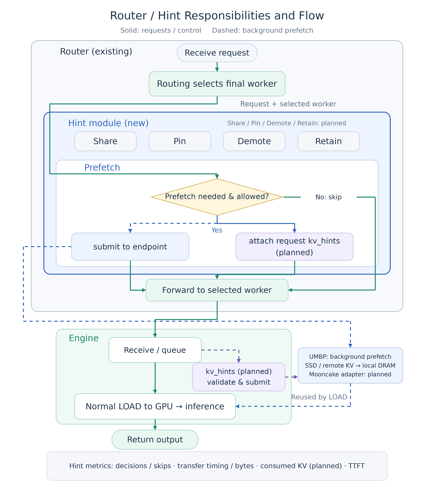

# [RFC] Router Hint Module for KV Cache Operations

**Authors:** [@TianDi101](https://github.com/TianDi101), Feiyue Zhai (`Feiyue.Zhai@amd.com`), [@wuyl1](https://github.com/wuyl1).

**Contributions:** @TianDi101 provided the initial cross-tier prefetch implementation; Feiyue Zhai contributed the cross-node sharing idea and implementation.

Status: draft for author review · 2026-11-05

## Summary

We propose a **Hint module in SGLang Router for extensible KV cache operations**. It uses request context, the selected worker, and available cache state to decide which hints to issue and observe their outcomes. The operation taxonomy follows the community proposal [#27574](https://github.com/sgl-project/sglang/issues/27574): Prefetch, Share, Pin, Demote, and Retain. Compatibility with these community-proposed operations is a design goal; Prefetch is our first implementation, with the remaining operations added according to backend capabilities. Backend adapters provide an extension point for cache systems, starting with UMBP and allowing future integrations such as Mooncake.

Our initial implementation is **async KV prefetch with UMBP**. After the routing policy selects a worker, the Router submits reusable prefix keys to that worker's UMBP backend before forwarding the request. UMBP prepares the KV in local DRAM from SSD or another node while the Engine proceeds through its normal request queue and LOAD path.

The implementation is available in [wuyl1/sglang:feat/router-umbp-prefetch](https://github.com/wuyl1/sglang/tree/feat/router-umbp-prefetch), at [commit d8f304f6](https://github.com/wuyl1/sglang/commit/d8f304f6b34e1f05a6c216e6b5b7952512b1b281). We have exercised both storage paths with DeepSeek-V4-Pro-0813 on AMD MI355X:

- **Cross-tier SSD → DRAM:** four matched comparisons observed input-throughput gains of **0.93%–2.42%**. The C64 500/1,000 GB pair reduced TTFT P50 by **26.83%** and P99 by **6.33%**.
- **Cross-node session migration:** compared with ordinary sharing with prefetch disabled, Router prefetch reduced TTFT P50 by **11.74%** and P99 by **8.21%**, with input throughput essentially unchanged (**+0.22%**).

The measurements below validate the initial UMBP Prefetch path. Other operations and backends require their own implementation and validation.

## Request flow and Hint boundary

Demand LOAD may need KV that has been offloaded to SSD or remains on a previous session worker. Starting the read in the Router creates an opportunity to overlap I/O with request delivery and Engine queueing. Prefetch begins after the request arrives and its destination is known.



**Scope of the diagram:** the direct async UMBP path is implemented and benchmarked for SSD → DRAM and remote-node → local DRAM. The sync/in-band path, execution of the community-proposed Share/Pin/Demote/Retain actions, Mooncake adapter, and consumed-KV attribution remain follow-up work.

**The Router waits for submission resolution, not READY.** Transfer and status polling continue in background tasks. Rejection or an uncertain submission leaves normal Engine LOAD available. Backend-local READY means complete KV is available in UMBP DRAM; Engine LOAD still restores it into GPU memory.

The Hint boundary owns decisions, submission, and observation for the selected destination. Routing policies retain worker selection and forwarding. In PD, current-prompt prefetch targets P; the normal P → D GPU KV transfer is a separate path.

**Proposed extension boundary:** operations express cache intent; backend adapters map prefix identity and destination to backend keys/endpoints, expose supported actions, and translate submission/status APIs. Decisions, budgets, task lifecycle, and observation stay in the Hint module. Each backend supports the actions it can execute; unsupported hints are recorded and normal generation continues. The current implementation calls UMBP directly; the shared adapter boundary and Mooncake integration are proposed work.

### Capabilities already present

| Capability | Current behavior |
| --- | --- |
| Prefix/key mapping | Uses request tokens, Engine-compatible block hashes, and configured component key templates. Only complete, bounded prefix blocks are considered. |
| Async control API | Calls UMBP `SubmitPrefetch` and `GetPrefetchStatus`; tracks request IDs and terminal task outcomes. |
| Shared work | Groups targets by physical endpoint, deduplicates identical TP keys, and reuses in-flight work for overlapping requests. |
| Bounded speculation | Caps prefix blocks, keys per RPC, and active batches/keys per endpoint; supports an optional static byte estimate. UMBP makes the final capacity/residency checks. |
| Retry and lifecycle | Stable action/operation IDs bind the target, keys, and options. Shared tasks survive individual request cancellation; reservations and metadata are retired within bounded lifetimes. Historical READY is not treated as permanent residency. |
| Observation | Records evaluated/skip reasons, issued/reused/accepted tasks, rejection and RPC errors, terminal states, acceptance/completion timing, and backend queue/execution timing. |

Clients send ordinary inference requests; **no client-supplied `kv_hints` is required**. Direct key generation must match the Engine tokenizer, block/hash mode, model identity, and cache layout. The current path skips requests with `cache_salt` or `extra_key`. UMBP checks actual residency; a routing snapshot is not treated as proof of local DRAM availability.

## Performance and test cases

The benchmark image combines the Router branch with MoRI async prefetch, strict-local PUT, and direct pool GET ([#850](https://github.com/ROCm/mori/pull/850), [#887](https://github.com/ROCm/mori/pull/887), [#888](https://github.com/ROCm/mori/pull/888)). It also retains the existing Engine external-linker/parallel-LOAD patches. Each matched pair uses the same software, nodes, routing, and workload, with Engine queue-triggered prefetch disabled. The switch is Router `submit_enabled`.

### Case 1: reusable agentic prefixes in SSD and DRAM

One TP4 prefill Engine and one TP8 decode Engine run on two nodes. AgentX replays long-context conversations with the report's local DRAM/SSD placement policy. Each arm sends for 3,600 seconds; C64/C192 indicate request concurrency. Capacities are decimal GB, and backend placement weights are held fixed within each pair.

1. Earlier turns populate KV across local DRAM and SSD. A later request reuses prefix blocks whose KV may remain on SSD.
2. **Prefetch off:** normal Engine LOAD reads the needed KV on demand.
3. **Prefetch on:** the Router submits prefix keys before forwarding; UMBP moves available SSD KV into DRAM so LOAD can reuse it.

TTFT columns show prefetch off → on (percentage change), in seconds.

| Concurrency; DRAM / SSD | Input throughput off → on (tok/s) | Change | TTFT P50 (s) | P90 (s) | P99 (s) |
| --- | ---: | ---: | ---: | ---: | ---: |
| C64; 750 / 750 GB | 329,424.38 → 332,480.18 | +0.93% | 2.363 → 2.164 (−8.42%) | 10.228 → 8.849 (−13.48%) | 27.697 → 30.493 (**+10.10%**) |
| C64; 750 / 750 GB, repeat | 327,489.21 → 333,043.48 | +1.70% | 2.525 → 1.983 (−21.47%) | 9.822 → 9.984 (+1.66%) | 30.683 → 28.257 (−7.90%) |
| C64; 500 / 1,000 GB | 325,766.77 → 333,658.47 | **+2.42%** | 2.752 → 2.014 (**−26.83%**) | 10.322 → 9.094 (−11.90%) | 28.777 → 26.957 (−6.33%) |
| C192; 750 / 750 GB | 777,802.65 → 789,870.47 | +1.55% | 4.090 → 4.053 (−0.92%) | 11.422 → 11.302 (−1.06%) | 39.643 → 38.865 (−1.96%) |

For C64 500/1,000 GB, TTFT P50 fell from **2.752 to 2.014 s** and P99 from **28.777 to 26.957 s**. Owner counters confirm SSD → DRAM movement. All arms reported zero request errors.

Input throughput and P50 improved in all four comparisons. Tail behavior varied: the original C64 750/750 P99 regression remains in the table. Its repeat improved P99 from **30.683 to 28.257 s**, but does not erase the original observation.

[Cross-tier measurements, including the repeat](benchmark-results.json).

### Case 2: cross-node prefetch after a session moves to another P

Three exclusive nodes run **2P1D: two TP4 prefill Engines and one TP8 decode Engine, DP1**. Each P has a 512 GiB UMBP DRAM pool. Both owners share a Master, use strict-local PUT, direct pool GET, and remote recache; SSD is disabled.

The case creates remote reuse through session migration:

1. A session initially runs on P0. Strict-local PUT keeps its offloaded previous-turn KV in P0's owner, while shared metadata makes it readable from P1.
2. An experimental `session_chbl` routing policy moves a later request to P1 when P0's waiting-uncached tokens exceed 4,096 and its load gap to the least-loaded P exceeds 5%, with a 20 s repin cooldown. Real HTTP load polls drive the decision; stale/missing state disables migration.
3. **Share:** P1 obtains reusable KV from P0 through normal demand remote GET during Engine LOAD.
4. **Share + Prefetch:** after selecting P1, the Router submits to P1's owner before forwarding. UMBP prepares available P0 KV in P1 DRAM through RDMA so normal LOAD can reuse it.

This routing policy is an experiment overlay used identically in both arms, not a requirement of prefetch. **Share and Share + Prefetch both retain cross-node sharing** and hash the same request tokens; Share + Prefetch additionally enables Router prefetch submission before forwarding.

AgentX replays from turn0 at concurrency 48, seed42, for a 1,200 s sending window with a 300 s ramp and no warmup. Model KV caches and both owner pools are cleared before each arm; the same image, Router binary, and model processes are reused.

The **No share** arm preserves local caching, session migration, and normal P → D GPU KV transfer. Each P owner uses an independent Master, with Router and Engine prefetch disabled; audits confirmed zero remote cache-read bytes.

| Metric | No share | Share | Share + Prefetch | Prefetch gain |
| --- | ---: | ---: | ---: | ---: |
| TTFT P50 | 1.024 s | 0.563 s | 0.497 s | **−11.74%** |
| TTFT P90 | 5.530 s | 2.137 s | 2.125 s | −0.58% |
| TTFT P99 | 12.985 s | 5.735 s | 5.264 s | **−8.21%** |
| Input throughput | 165,340.9 tok/s | 170,159.1 tok/s | 170,541.1 tok/s | +0.22% |
| Output throughput | 1,659.1 tok/s | 1,710.5 tok/s | 1,711.9 tok/s | +0.09% |

The three arms show the observed trend; No share ran on a separate node allocation. The last column gives the percentage change of Share + Prefetch relative to Share.

The matched sharing pair shows an **additional TTFT benefit over ordinary sharing**, with essentially unchanged throughput. It retained 2,473/2,476 complete records, zero request errors, and 100% reported timing coverage. Each arm canceled three outstanding requests at the common end-of-phase limit. TTFT percentiles were independently recomputed; an invalid initial on attempt was excluded and replaced after correcting client configuration delivery.

On accepted 1,873 prefetch tasks, completing 1,241,167 key entries across tasks. Outcomes were 54 READY, 1,102 PARTIAL, and 717 FAILED. A batch can include unavailable cold/new-turn keys; these counts describe tasks, not unique keys, useful-prefetch coverage, or inference errors.

[Cross-node measurements and audit summary](benchmark-results.json).

## Configuration and usage example

The following uses the tested DeepSeek-V4 key layout, with documentation IPs replacing experiment addresses. P0/P1 Engine URLs map to their UMBP endpoints. For this shared component keyspace, a single rank entry per owner is sufficient.

```json
{
  "worker_targets": {
    "http://192.0.2.10:6100": [
      {"rank": 0, "endpoint": "http://192.0.2.10:19041"}
    ],
    "http://192.0.2.20:6100": [
      {"rank": 0, "endpoint": "http://192.0.2.20:19041"}
    ]
  },
  "block_size": 256,
  "is_bigram": false,
  "key_templates": [
    "-model_{hash}_pp0_deepseek_v4_c4",
    "-model_{hash}_pp0_deepseek_v4_c4_indexer",
    "-model_{hash}_pp0_deepseek_v4_c4_indexer_scale",
    "-model_{hash}_pp0_deepseek_v4_c128"
  ],
  "submit_enabled": true
}
```

Save this as `prefetch.json` and add **`--umbp-prefetch-config /path/prefetch.json`** to the existing Router launch command. Engines and UMBP owners must already be configured for external KV storage. The templates reflect the benchmark's `/model` mount and component layout; adjust them, the endpoints, tokenizer, and page/hash settings to match the deployed Engine. Rank-specific layouts need their actual rank entries.

Send ordinary OpenAI-compatible requests through the Router, for example an existing long-prefix agentic turn:

```bash
curl http://127.0.0.1:8000/v1/chat/completions \
  -H 'Content-Type: application/json' \
  --data-binary @agentic-turn.json
```

`agentic-turn.json` is a normal request with `model`, `messages`, and generation options. A reusable long prefix supplies complete cache blocks; new or missing keys may yield partial prefetch. No hint envelope is needed.

Current defaults allow 4,096 complete prefix blocks, 4,096 keys per RPC, and 16 active batches/65,536 keys per physical endpoint. `timeout_ms` and `lease_ttl_ms` default to 5,000 ms; polling defaults to 2 ms. Optional `bytes_per_key`/`max_inflight_bytes` provide an estimated byte cap, not live DRAM capacity accounting.

For a matched comparison, set **`"submit_enabled": false`** and restart the Router while retaining the same configuration, hashing, routing, sharing, and Engine LOAD settings. The file is loaded at startup. Omitting the CLI option disables the coordinator entirely. Disable any Engine-triggered prefetch when isolating the Router effect.

For example, the C64 cross-tier run uses the experiment's AIPerf client and AgentX trace loader:

```bash
aiperf profile --scenario agentx \
  --url http://127.0.0.1:8000 \
  --model deepseek-ai/DeepSeek-V4-Pro-0813 \
  --tokenizer deepseek-ai/DeepSeek-V4-Pro-0813 \
  --tokenizer-trust-remote-code \
  --public-dataset semianalysis_cc_traces_weka_062126 \
  --concurrency 64 --benchmark-duration 3600 \
  --output-artifact-dir ./artifacts/c64
```

The dataset is `semianalysisai/cc-traces-weka-062126`; the tested client/loader version is recorded in the retained run artifacts linked with the results. The cross-node replay uses the same trace family with concurrency 48, a 1,200 s window, a 300 s ramp, and the cold-reset/migration setup described above.

## Correctness checks and measurement boundaries

We also performed a [real RDMA functional check](benchmark-results.json): prefetch eight objects, observe READY, GET and verify complete bytes, then confirm that the subsequent local GET adds no RDMA. The transfer moved exactly **4,320,256 bytes**.

For integration checks, use Router decisions/task logs to establish submission, backend counters to confirm the intended SSD/RDMA path, and byte checks to verify the copy. Measure request TTFT/throughput separately: **accepted or READY tasks alone do not prove inference benefit**. Per-request attribution of consumed prefetched KV remains a follow-up.

The tables report observed results, without a statistical-significance claim. The cross-node migration prefetch result is one valid pair. Nine additional cold-prefix burst pairs showed small, variable improvements; their pooled P99 increased 7.38%. These tests also do not isolate Router triggering versus Engine triggering. Total SSD/remote GET counters include demand and prefetch activity.

## Proposed upstream scope

Introduce the Hint module around the existing opt-in async prefetch coordinator, with a small operation/adapter boundary and UMBP as its initial backend. Preserve the configuration, physical-pool deduplication, bounded lifecycle, and normal LOAD behavior. Implement further community-proposed actions and backend adapters incrementally as use cases and backend capabilities justify them.

Community feedback is requested on the integration point after final worker selection, the operation/backend adapter boundary with UMBP as the first implementation, and a minimal path for reporting actual consumption. For in-band delivery, we aim to reuse the versioned `kv_hints` envelope proposed in [#36224](https://github.com/sgl-project/sglang/issues/36224), with transport provided by merged PR [#38891](https://github.com/sgl-project/sglang/pull/38891). That PR does not define or execute action types. Engine execution, per-request wait policy, further community-proposed actions, and other backend adapters require separate implementation and validation.

## References

- [Source branch](https://github.com/wuyl1/sglang/tree/feat/router-umbp-prefetch) and [implemented coordinator](https://github.com/wuyl1/sglang/blob/d8f304f6b34e1f05a6c216e6b5b7952512b1b281/sgl-router/src/prefetch.rs).
- [Benchmark measurements, validation summary, software provenance, and source artifact checksums](benchmark-results.json).

The accompanying `benchmark-results.json` contains summarized measurements and source artifact checksums. Full per-request exports and detailed runtime audits remain in the local experiment archive.
